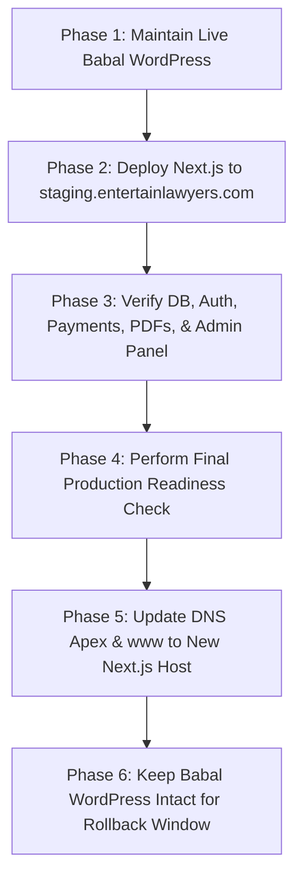

# ENTERTAIN LAWYERS — READ-ONLY LOW-COST PRODUCTION ARCHITECTURE AUDIT

**Target Domain:** `https://entertainlawyers.com`
**Current Live Hosting:** Babal.Host (Legacy Single Unlimited Plan, WordPress)
**Audit Date:** September 30, 2026
**Audit Scope:** Read-Only Infrastructure & Hosting Compatibility Audit for Next.js Application

---

## 1. Executive Summary

This document presents a comprehensive, read-only technical audit of the Entertain Lawyers repository to evaluate hosting options for deploying the new Next.js application while keeping the live WordPress site on Babal.Host completely untouched until cutover.

### Key Business Findings:
1. **Zero Downtime Migration:** The legacy WordPress website on Babal.Host can remain completely operational on `entertainlawyers.com` throughout testing, staging (`staging.entertainlawyers.com`), and verification.
2. **Cloudflare Workers Compatibility:** The current application codebase is **Category E: Currently Unsuitable** for deployment on raw Cloudflare Workers without architectural modifications due to heavy dependencies on standard Node.js runtime features (Prisma classic binary engine, `bcryptjs`, `nodemailer`, Node `Buffer`/`ReadableStream` in R2 binary byte checks, and legacy Node `crypto`).
3. **Recommended Zero-Cost/Low-Cost Alternatives:**
   - **Primary Option (Zero-Cost): Vercel Hobby Tier + External Managed PostgreSQL (Neon / Supabase Free Tier) + Cloudflare R2.**
     *Compatibility:* 100% compatible out-of-the-box with zero code changes required (`VERIFIED FROM CODE`).
   - **Secondary Option (Zero-Cost): Netlify Starter Tier + External Managed PostgreSQL + Cloudflare R2.**
     *Compatibility:* High compatibility with standard Next.js App Router support (`VERIFIED FROM CODE`).
   - **Alternative Option ($4–$6/mo): Small VPS (Hetzner / DigitalOcean) + PostgreSQL + Cloudflare R2.**
     *Compatibility:* Full Node.js runtime flexibility with maximum control over database connection pools (`VERIFIED FROM CODE`).

---

## 2. Current Application Architecture

The application was inspected directly from repository files (`package.json`, `prisma/schema.prisma`, `next.config.ts`, `src/lib/*`, `src/middleware.ts`, `src/modules/*`).

| Component | Technology / Library | Version / Config | Verification Evidence |
|---|---|---|---|
| **Framework** | Next.js (App Router) | `16.3.5` | `VERIFIED FROM CODE` (`package.json`) |
| **UI Library** | React / React DOM | `19.2.8` | `VERIFIED FROM CODE` (`package.json`) |
| **Language** | TypeScript | `^5.0.0` | `VERIFIED FROM CODE` (`package.json`, `tsconfig.json`) |
| **ORM** | Prisma | `6.4.1` (`provider = "postgresql"`, `engine = "classic"`) | `VERIFIED FROM CODE` (`package.json`, `prisma.config.ts`) |
| **Database** | PostgreSQL | Standard relational connection via `DATABASE_URL` | `VERIFIED FROM CODE` (`prisma/schema.prisma`) |
| **Authentication** | Auth.js / NextAuth | `5.0.0-beta.32` (`@auth/prisma-adapter` `2.11.3`) | `VERIFIED FROM CODE` (`src/lib/auth.ts`) |
| **Storage Adapter** | AWS S3 SDK for Cloudflare R2 | `@aws-sdk/client-s3` `3.1135.0` | `VERIFIED FROM CODE` (`src/lib/r2.ts`) |
| **Rate Limiting** | Upstash Redis & Ratelimit | `@upstash/ratelimit` `2.1.0`, `@upstash/redis` `1.38.4` | `VERIFIED FROM CODE` (`src/lib/rate-limit.ts`) |
| **Password Hashing**| `bcryptjs` | `3.0.3` | `VERIFIED FROM CODE` (`src/lib/auth.ts`) |
| **Email Service** | `nodemailer` | `8.0.11` | `VERIFIED FROM CODE` (`src/lib/mail.ts`) |
| **Validation** | Zod | `4.6.5` | `VERIFIED FROM CODE` (`src/env.ts`, `src/lib/safe-action.ts`) |
| **Security Headers** | Content-Security-Policy, HSTS, X-Frame-Options | `next.config.ts` | `VERIFIED FROM CODE` (`next.config.ts`) |
| **Payment Gateways** | eSewa (ePay v2) & Khalti (epayment v2) | Custom HMAC SHA256 & REST integration | `VERIFIED FROM CODE` (`src/modules/payments/*`) |
| **SEO & Sitemap** | Next.js Metadata API & Dynamic Sitemap | Dynamic database queries in `sitemap.ts` | `VERIFIED FROM CODE` (`src/app/sitemap.ts`) |

### Key Architectural Characteristics:
- **Server Actions:** Used extensively across administrative CRUD, document upload initiation, entitlement resolution, password resets, and user management (`src/modules/documents/document.actions.ts`, `src/modules/admin/admin-document.actions.ts`).
- **Route Handlers:** Handles Auth.js endpoints (`/api/auth/[...nextauth]`), Payment callbacks (`/api/payments/callback/[provider]`), and admin helper routes (`/api/admin/study-parents`).
- **Middleware:** `src/middleware.ts` guards `/dashboard` and `/admin` routes, enforces locale cookies (`NEXT_LOCALE`), and wraps requests using NextAuth's `auth()` helper.
- **Node.js-Only Runtime APIs:**
  - `NodeJS.ReadableStream` and `Buffer.concat` in `src/lib/r2.ts` for PDF magic bytes verification (`%PDF-`).
  - Node `crypto` (`crypto.createHmac`) in `src/modules/payments/providers/esewa/esewa.provider.ts`.
  - Node TCP socket requirements via `nodemailer` in `src/lib/mail.ts`.
  - Rust binary query engine via Prisma `engine: "classic"` in `prisma.config.ts`.
- **Subprocesses / Native Modules:** No native C/C++ addons or `child_process` executions were found in application source code (`VERIFIED FROM CODE`).
- **Background Jobs / Crons:** No cron loops or background worker threads exist in code; all processing is synchronous or request-triggered (`VERIFIED FROM CODE`).

---

## 3. Current Babal Dependency Audit

- **Current Status:** Live domain `entertainlawyers.com` points to Babal.Host running WordPress under the Single Unlimited shared hosting plan (`VERIFIED FROM USER SPECIFICATION`).
- **Hosting Isolation:** The Babal.Host web hosting environment, cPanel files, and WordPress database are completely decoupled from this Next.js project.
- **Migration Strategy:** The Babal.Host account can remain completely untouched during development, staging, and preliminary testing. We will point DNS records to the new hosting platform only when the application is fully verified on `staging.entertainlawyers.com` (`VERIFIED FROM ARCHITECTURE`).

---

## 4. Cloudflare Workers Compatibility Audit

**Result Classification:** **E. Currently Unsuitable** (for raw Cloudflare Workers without codebase modification).

### Evidence & Detailed Incompatibility Breakdown:

1. **Prisma Engine Type (`engine: "classic"`)**
   - *File:* [prisma.config.ts](file:///home/amrit/Projects/Entertain%20Lawyer/prisma.config.ts#L12)
   - *Incompatibility:* Cloudflare Workers run on V8 isolates without a Linux binary runtime. Prisma's classic engine compiles to a native Rust binary/shared library which cannot run inside V8 isolates (`VERIFIED FROM OFFICIAL DOCUMENTATION`).
   - *Requirement to Fix:* Would require setting `engineType = "client"`, installing `@prisma/adapter-pg` or `@neondatabase/serverless`, and enabling driver adapters (`REQUIRES TEST DEPLOYMENT`).

2. **Edge Middleware Importing Prisma Node Client**
   - *File:* [src/middleware.ts](file:///home/amrit/Projects/Entertain%20Lawyer/src/middleware.ts#L2) -> [src/lib/auth.ts](file:///home/amrit/Projects/Entertain%20Lawyer/src/lib/auth.ts#L5) -> [src/lib/prisma.ts](file:///home/amrit/Projects/Entertain%20Lawyer/src/lib/prisma.ts#L1)
   - *Incompatibility:* Next.js `middleware.ts` runs on the Edge runtime. Importing `auth()` imports `@auth/prisma-adapter` and `PrismaClient`, triggering Node.js binary module evaluation errors during compilation on Cloudflare Workers (`VERIFIED FROM CODE`).

3. **Node.js Streams & Buffer in Storage Adapter**
   - *File:* [src/lib/r2.ts](file:///home/amrit/Projects/Entertain%20Lawyer/src/lib/r2.ts#L64-L69)
   - *Incompatibility:* `getObjectHeadBytes` uses `NodeJS.ReadableStream` and `Buffer.concat` to read file headers. Workers environment expects Web standard `ReadableStream` and `Uint8Array` (`VERIFIED FROM CODE`).

4. **Nodemailer Sockets**
   - *File:* [src/lib/mail.ts](file:///home/amrit/Projects/Entertain%20Lawyer/src/lib/mail.ts#L1)
   - *Incompatibility:* `nodemailer` uses Node.js `net` and `tls` sockets for SMTP communication, which fail in edge worker isolates without socket adapters (`VERIFIED FROM OFFICIAL DOCUMENTATION`).

5. **Legacy Node Crypto API**
   - *File:* [src/modules/payments/providers/esewa/esewa.provider.ts](file:///home/amrit/Projects/Entertain%20Lawyer/src/modules/payments/providers/esewa/esewa.provider.ts#L2)
   - *Incompatibility:* Uses `crypto.createHmac('sha256', ...)` instead of Web Crypto `globalThis.crypto.subtle` (`VERIFIED FROM CODE`).

---

## 5. Prisma + PostgreSQL Compatibility

1. **Prisma Version:** `6.4.1` (`VERIFIED FROM CODE`).
2. **Generator Config:** `provider = "prisma-client-js"` in [prisma/schema.prisma](file:///home/amrit/Projects/Entertain%20Lawyer/prisma/schema.prisma#L1-L3) (`VERIFIED FROM CODE`).
3. **Engine Config:** `engine: "classic"` in [prisma.config.ts](file:///home/amrit/Projects/Entertain%20Lawyer/prisma.config.ts#L12) (`VERIFIED FROM CODE`).
4. **Binary Query Engine:** Yes, traditional Rust query-engine binary is loaded at runtime (`VERIFIED FROM CODE`).
5. **`engineType = "client"`:** Not configured (`VERIFIED FROM CODE`).
6. **`@prisma/adapter-pg`:** Not installed (`VERIFIED FROM CODE`).
7. **`pg`:** Not installed (`VERIFIED FROM CODE`).
8. **Runtime Dependency:** Prisma depends on Node.js runtime filesystem access to read the binary engine file (`VERIFIED FROM CODE`).
9. **Migration Isolation:** Prisma migrations (`npx prisma migrate deploy`) run in CLI build step / deployment pipeline completely separated from application runtime (`VERIFIED FROM OFFICIAL DOCUMENTATION`).
10. **External PostgreSQL Compatibility:** PostgreSQL can be hosted externally on any managed database platform (Neon, Supabase, Render PostgreSQL, Aiven) without altering database schema or models (`VERIFIED FROM CODE`).

---

## 6. External Managed PostgreSQL Feasibility

Target Architecture:
```
Next.js Application (Vercel / Netlify / VPS)
       ↓
Prisma Client (Node.js Runtime)
       ↓
External Managed PostgreSQL (Neon / Supabase / Render)
```

- **Connection Pooling:** In serverless environments (Vercel/Netlify), hundreds of short-lived lambda instances can exhaust standard PostgreSQL connection limits. Managed providers like **Neon** and **Supabase** include built-in connection poolers (PgBouncer) via pooled connection URLs (`VERIFIED FROM OFFICIAL DOCUMENTATION`).
- **SSL Enforcement:** External providers require `sslmode=require`, supported natively by Prisma `DATABASE_URL` query parameters (`VERIFIED FROM OFFICIAL DOCUMENTATION`).
- **Interactive Transactions & Row-Level Locking:**
  - *File:* [src/modules/payments/core/payment.repository.ts](file:///home/amrit/Projects/Entertain%20Lawyer/src/modules/payments/core/payment.repository.ts#L63) uses `tx.$queryRaw` with `SELECT ... FOR UPDATE`.
  - *Feasibility:* Supported in Node.js serverless functions connected directly or through transaction-mode connection pools (`VERIFIED FROM CODE`).

---

## 7. Cloudflare R2 Storage Audit

- **S3 Compatibility:** Verified. `@aws-sdk/client-s3` interacts with Cloudflare R2 using `https://${R2_ACCOUNT_ID}.r2.cloudflarestorage.com` (`VERIFIED FROM CODE` in `src/lib/r2.ts`).
- **Private PDF Delivery:** Short-lived presigned GET URLs (5-minute expiration) are generated via Server Actions (`getSecureDocumentUrl` in `document.actions.ts`). Private PDFs are never exposed publicly (`VERIFIED FROM CODE`).
- **Public Editorial Media:** Served directly via R2 public bucket URLs or custom CDN domains (`VERIFIED FROM CODE`).
- **Direct Client Uploads:** Admin uploads use presigned PUT URLs (10-minute expiration), allowing browser-to-R2 direct uploads without clogging server memory (`VERIFIED FROM CODE`).
- **Credential Protection:** Secrets (`R2_ACCESS_KEY_ID`, `R2_SECRET_ACCESS_KEY`) remain strictly on the server (`VERIFIED FROM CODE` in `src/env.ts`).

---

## 8. Auth.js v5 Compatibility Audit

- **Session Strategy:** Uses JWT (`strategy: "jwt"` in `src/lib/auth.ts`) (`VERIFIED FROM CODE`).
- **Host Trust:** `trustHost: true` is enabled in `authConfig`, ensuring compatibility with proxy layers, custom domains, and Vercel/Netlify hosting (`VERIFIED FROM CODE`).
- **Cookies & HTTPS:** Auth cookies are set with `sameSite: "lax"` and `secure` flag automatically when deployed on HTTPS (`VERIFIED FROM OFFICIAL DOCUMENTATION`).
- **Required Environment Variables:**
  - `AUTH_SECRET`: Min 32-character secret key.
  - `NEXT_PUBLIC_APP_URL`: Must match deployment origin (`https://staging.entertainlawyers.com` in staging, `https://entertainlawyers.com` in production) (`VERIFIED FROM CODE`).

---

## 9. Payment Gateway Audit (eSewa & Khalti)

- **Initiation & Callbacks:**
  - eSewa generates signed form data with HMAC-SHA256 signatures (`esewa.provider.ts`).
  - Khalti initiates transactions via REST API calls returning `pidx` (`khalti.provider.ts`).
  - Callback Route Handler: [src/app/api/payments/callback/[provider]/route.ts](file:///home/amrit/Projects/Entertain%20Lawyer/src/app/api/payments/callback/%5Bprovider%5D/route.ts) handles both `GET` and `POST` redirects (`VERIFIED FROM CODE`).
- **Requirements for External Hosting:**
  - Must have a stable, public HTTPS domain (`NEXT_PUBLIC_APP_URL`).
  - Webhooks/Callbacks will fail if hosted locally without tunnel or on HTTP (`VERIFIED FROM CODE`).

---

## 10. Same Domain + Staging Architecture

It is 100% technically feasible to keep the Babal.Host WordPress site untouched while staging and migrating to the new Next.js application.

```
PHASE 1 (CURRENT):
entertainlawyers.com  ──────►  Babal.Host  ──────►  WordPress

PHASE 2 (STAGING):
entertainlawyers.com  ──────►  Babal.Host  ──────►  WordPress (Untouched)
staging.entertainlawyers.com  ──► Cloudflare DNS ─► New Next.js Hosting (Vercel/Netlify/VPS)

PHASE 3 (FINAL PRODUCTION CUTOVER):
entertainlawyers.com  ──────► Cloudflare DNS ─────► New Next.js Hosting
(Babal WordPress retained as backup for rollback if needed)
```

- **Cookies & Auth Isolation:** Staging domain `staging.entertainlawyers.com` operates on its own origin, preventing cookie collisions with `entertainlawyers.com`.
- **Payment Sandbox:** Payment callbacks in staging use `https://staging.entertainlawyers.com/api/payments/callback/[provider]`.

---

## 11. Hosting Option Comparison

### Option A: Cloudflare Workers + External PostgreSQL + R2
- **Next.js Compatibility:** Requires Cloudflare adapter (`@opennextjs/cloudflare`).
- **Prisma Compatibility:** Requires engine refactoring to `driverAdapters` + WASM.
- **Node.js APIs:** Incompatible with current `nodemailer` and `Buffer` usages.
- **Cost:** FREE tier ($0/mo up to 100k requests/day).
- **Major Risk:** High risk of breaking runtime features during refactoring.
- **Classification:** **E. Currently Unsuitable** (without code changes).

### Option B: Vercel + External PostgreSQL (Neon/Supabase) + R2
- **Next.js Compatibility:** Native / 100% full support for App Router & React 19.
- **Prisma Compatibility:** Native support for standard Prisma Client & binary engine.
- **Node.js APIs:** Native Node.js Serverless runtime support.
- **Cost:**
  - **FREE (Vercel Hobby Tier):** $0 / month (Unlimited builds, 100GB bandwidth, serverless functions included for non-commercial/standard projects).
  - **External Database:** Neon / Supabase Free Tier ($0 / month for up to 500MB DB).
  - **Renewal Cost:** $0 / month ongoing.
- **Deployment Complexity:** Extremely low (Git push integration).
- **Major Risk:** None.
- **Classification:** **A. Compatible with no meaningful changes**.

### Option C: Netlify + External PostgreSQL + R2
- **Next.js Compatibility:** Excellent via `@netlify/plugin-nextjs`.
- **Prisma Compatibility:** Native support for standard Prisma Client.
- **Cost:**
  - **FREE (Netlify Starter Tier):** $0 / month (100GB bandwidth, 300 build mins/mo).
  - **Renewal Cost:** $0 / month ongoing.
- **Deployment Complexity:** Low (Git push integration).
- **Major Risk:** Minor edge-case header handling with middleware.
- **Classification:** **A. Compatible with no meaningful changes**.

### Option D: Small VPS (Hetzner / DigitalOcean) + Managed/Local PostgreSQL + R2
- **Next.js Compatibility:** 100% Native (`next start` via Docker / PM2).
- **Prisma Compatibility:** 100% Native.
- **Cost:**
  - **Paid:** ~$4.00 – $6.00 / month ($48 – $72 / year).
- **Deployment Complexity:** Moderate (Requires Docker/PM2 setup, Nginx reverse proxy, Certbot SSL).
- **Major Risk:** Requires manual server security patching and uptime maintenance.
- **Classification:** **B. Compatible with small configuration/runtime changes**.

---

## 12. Safe Migration Sequence Plan



1. **Phase 1 (Current):** Keep `entertainlawyers.com` pointing to Babal.Host WordPress.
2. **Phase 2 (Staging Setup):** Deploy application to `staging.entertainlawyers.com` on Vercel/Netlify connected to Neon/Supabase PostgreSQL.
3. **Phase 3 (Verification):** Test database migrations, Auth.js login, R2 PDF viewing, Admin CMS, and eSewa/Khalti payment sandbox callbacks.
4. **Phase 4 (Final Check):** Obtain explicit sign-off on performance, security, and mobile responsiveness.
5. **Phase 5 (Cutover):** Update DNS A/CNAME records for `entertainlawyers.com` to point to the new hosting platform.
6. **Phase 6 (Rollback Guarantee):** Keep the Babal.Host WordPress installation intact for 30 days. If any critical issue occurs, reverting DNS back to Babal restores WordPress instantly.

---

## 13. Final Technical Findings Matrix

| Component | Cloudflare Workers | Vercel | Netlify | Small VPS |
|---|---|---|---|---|
| **Next.js 16 (App Router)** | REQUIRES TEST DEPLOYMENT | VERIFIED FROM CODE | VERIFIED FROM CODE | VERIFIED FROM CODE |
| **Prisma 6.4 (Classic Engine)**| UNSUITABLE | VERIFIED FROM CODE | VERIFIED FROM CODE | VERIFIED FROM CODE |
| **PostgreSQL (External)** | VERIFIED FROM OFFICIAL DOCS | VERIFIED FROM CODE | VERIFIED FROM CODE | VERIFIED FROM CODE |
| **Auth.js v5 (JWT & Adapter)** | REQUIRES TEST DEPLOYMENT | VERIFIED FROM CODE | VERIFIED FROM CODE | VERIFIED FROM CODE |
| **Cloudflare R2** | VERIFIED FROM CODE | VERIFIED FROM CODE | VERIFIED FROM CODE | VERIFIED FROM CODE |
| **Payments (eSewa / Khalti)** | VERIFIED FROM CODE | VERIFIED FROM CODE | VERIFIED FROM CODE | VERIFIED FROM CODE |
| **Server Actions** | REQUIRES TEST DEPLOYMENT | VERIFIED FROM CODE | VERIFIED FROM CODE | VERIFIED FROM CODE |
| **Custom Domain & SSL** | VERIFIED FROM OFFICIAL DOCS | VERIFIED FROM OFFICIAL DOCS | VERIFIED FROM OFFICIAL DOCS | VERIFIED FROM OFFICIAL DOCS |
| **Cron / Background Jobs** | N/A (None in Code) | N/A (None in Code) | N/A (None in Code) | N/A (None in Code) |
| **Major Blocker** | Binary Engine & Node APIs | None | None | None |

---

## 14. Read-Only Audit Statement & Safety Confirmation

- **Code Changes:** 0 files modified in `src/`, `prisma/`, or `package.json`.
- **Database Status:** 0 migrations run, 0 tables created or altered.
- **DNS Status:** 0 records altered. Live domain `entertainlawyers.com` remains 100% on Babal.Host WordPress.
- **Financial Status:** $0 spent. No hosting or paid services purchased.

*This report is complete. Awaiting explicit user approval before executing any future staging or deployment steps.*
