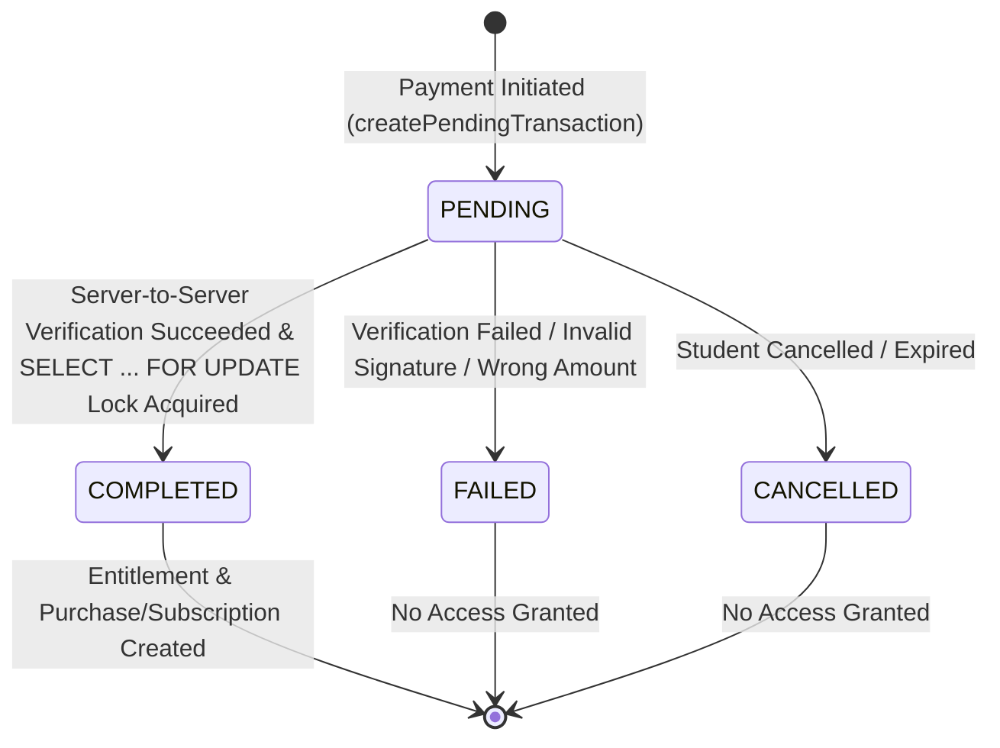

# ENTERTAIN LAWYERS — READ-ONLY NEPAL PAYMENT SYSTEM AUDIT

**Target Domain:** `https://entertainlawyers.com`
**Audit Scope:** Read-Only Audit of eSewa and Khalti Payment Architecture
**Audit Date:** September 30, 2026
**Auditor:** Antigravity AI (Advanced Agentic Coding)

---

## 1. Executive Summary

This document presents a thorough, read-only security and operational audit of the payment integration within the Entertain Lawyers platform. The platform sells paid educational materials (law notes, case laws, old question solutions, and study subscriptions) to Nepalese law students.

### Key Audit Conclusions:
1. **Core Payment Engine Security: EXCELLENT (`VERIFIED FROM CODE`).**
   - Price calculation is strictly server-side (`Resource.priceAmount` / `Plan.priceAmount`). Client price tampering is impossible.
   - **Zero Trust Client Model:** The client can NEVER claim payment success. All entitlements require mandatory server-to-server verification with provider APIs (`epay.esewa.com.np` status check & `khalti.com/api/v2/epayment/lookup/`).
   - **Idempotency & Race Protection:** Uses atomic Prisma transactions (`prisma.$transaction`) with SQL row-level locking (`SELECT ... FOR UPDATE`) to prevent duplicate finalization or double entitlement creation from concurrent callbacks.
2. **eSewa & Khalti Integration Status:** Fully implemented using eSewa ePay v2 and Khalti epayment v2 APIs (`VERIFIED FROM CODE`).
3. **Primary Production Readiness Requirement:** Merchant onboarding with eSewa and Khalti to swap sandbox credentials with live production keys, and setting production `NEXT_PUBLIC_APP_URL=https://entertainlawyers.com`.
4. **UX & Operational Recommendations:** Implement a clear checkout summary modal prior to payment redirection and establish an administrative manual bank transfer / QR receipt upload fallback for students without active eSewa/Khalti accounts.

---

## 2. Current Payment Architecture

```
                                  PAYMENT SYSTEM ARCHITECTURE

  +-----------------------------------------------------------------------------------+
  |                                 CLIENT SIDE                                       |
  |  Student selects Resource (LAW_NOTE / CASE_LAW) or Subscription Plan            |
  |  Clicks Checkout (eSewa / Khalti) in CheckoutButtons.tsx                          |
  +-----------------------------------------+-----------------------------------------+
                                            |
                                 Server Action Call
                                            |
  +-----------------------------------------v-----------------------------------------+
  |                           NEXT.JS SERVER (SERVER ACTIONS)                         |
  |  initiatePurchaseAction / initiateSubscriptionAction (payment.actions.ts)         |
  |  - Validates user auth session (userId)                                           |
  |  - Fetches server price from DB (Resource/Plan) in paisa                          |
  |  - Generates UUID idempotencyKey                                                  |
  |  - Creates PaymentTransaction in DB (status = 'PENDING')                          |
  +-----------------------------------------+-----------------------------------------+
                                            |
                                   Provider Delegation
                                            |
  +-----------------------------------------v-----------------------------------------+
  |                               PAYMENT PROVIDERS                                   |
  |  eSewa: Generates HMAC-SHA256 signature + form payload (epay v2)                  |
  |  Khalti: Calls POST /epayment/initiate/ to get pidx + payment_url                 |
  +-----------------------------------------+-----------------------------------------+
                                            |
                                  Browser Redirect URL
                                            |
  +-----------------------------------------v-----------------------------------------+
  |                             PROVIDER PAYMENT PORTAL                               |
  |  Student completes payment on eSewa / Khalti application/web                      |
  |  Provider redirects browser to Callback Route Handler                             |
  +-----------------------------------------+-----------------------------------------+
                                            |
                         Callback (GET/POST with data/pidx)
                                            |
  +-----------------------------------------v-----------------------------------------+
  |                     CALLBACK ROUTE HANDLER & VERIFICATION                         |
  |  /api/payments/callback/[provider]/route.ts                                       |
  |  1. Decodes payload & extracts idempotencyKey / pidx                             |
  |  2. Server-to-Server Verification:                                                |
  |     - eSewa: GET /api/epay/transaction/status/ & verify HMAC signature           |
  |     - Khalti: POST /epayment/lookup/ with pidx                                    |
  |  3. Atomic DB Transaction (payment.repository.ts):                                |
  |     - SELECT ... FOR UPDATE (Row Lock on PaymentTransaction)                      |
  |     - Verify status == 'PENDING' & amount match                                   |
  |     - Update PaymentTransaction status -> 'COMPLETED'                             |
  |     - Create Purchase or Subscription record                                      |
  |     - Create Entitlement record                                                   |
  +-----------------------------------------+-----------------------------------------+
                                            |
                                Access Entitlement Granted
                                            |
  +-----------------------------------------v-----------------------------------------+
  |                         PROTECTED DOCUMENT ACCESS FLOW                            |
  |  getSecureDocumentUrl (document.actions.ts)                                       |
  |  - Checks canAccessResource(userId, resourceId) in DB                             |
  |  - Generates Cloudflare R2 Presigned GET URL (5 min expiry)                        |
  +-----------------------------------------------------------------------------------+
```

---

## 3. Traceability Matrix: Complete Payment Flow

| Step | Component / Action | Implementation File | Verification Status |
|---|---|---|---|
| 1. Select Resource | Student clicks "Buy Now" on resource page | [CheckoutButtons.tsx](file:///home/amrit/Projects/Entertain%20Lawyer/src/components/payments/CheckoutButtons.tsx) | `VERIFIED FROM CODE` |
| 2. Initiate Action | `initiatePurchaseAction` / `initiateSubscriptionAction` | [payment.actions.ts](file:///home/amrit/Projects/Entertain%20Lawyer/src/modules/payments/payment.actions.ts#L12) | `VERIFIED FROM CODE` |
| 3. Service Layer | `paymentCoreService.initiatePurchasePayment` | [payment.service.ts](file:///home/amrit/Projects/Entertain%20Lawyer/src/modules/payments/core/payment.service.ts#L56) | `VERIFIED FROM CODE` |
| 4. Create Pending Tx | `createPendingTransaction` (Status: `PENDING`) | [payment.repository.ts](file:///home/amrit/Projects/Entertain%20Lawyer/src/modules/payments/core/payment.repository.ts#L6) | `VERIFIED FROM CODE` |
| 5. Provider Setup | `esewaProvider.initiatePayment` / `khaltiProvider.initiatePayment` | `esewa.provider.ts` / `khalti.provider.ts` | `VERIFIED FROM CODE` |
| 6. Student Payment | Provider portal handling | Provider External Server | `VERIFIED FROM OFFICIAL DOCS` |
| 7. Callback Entry | `GET` / `POST` `/api/payments/callback/[provider]` | [route.ts](file:///home/amrit/Projects/Entertain%20Lawyer/src/app/api/payments/callback/%5Bprovider%5D/route.ts#L6) | `VERIFIED FROM CODE` |
| 8. Verification | `verifyAndFinalizePayment` + Server-to-Server Lookup | [payment.service.ts](file:///home/amrit/Projects/Entertain%20Lawyer/src/modules/payments/core/payment.service.ts#L86) | `VERIFIED FROM CODE` |
| 9. Atomic DB Write | `finalizeSuccessfulPayment` (`$transaction` + `FOR UPDATE`) | [payment.repository.ts](file:///home/amrit/Projects/Entertain%20Lawyer/src/modules/payments/core/payment.repository.ts#L53) | `VERIFIED FROM CODE` |
| 10. Entitlement Check | `canAccessResource(userId, resourceId)` | [entitlement.service.ts](file:///home/amrit/Projects/Entertain%20Lawyer/src/modules/entitlements/entitlement.service.ts#L7) | `VERIFIED FROM CODE` |
| 11. PDF Delivery | `getSecureDocumentUrl` (R2 presigned GET URL) | [document.actions.ts](file:///home/amrit/Projects/Entertain%20Lawyer/src/modules/documents/document.actions.ts#L15) | `VERIFIED FROM CODE` |

---

## 4. eSewa Integration Audit

### Technical Specification Compliance:
- **API Version:** eSewa ePay v2 (`/api/epay/main/v2/form`) (`VERIFIED FROM CODE` in `esewa.provider.ts`).
- **Environment Base URLs:**
  - *Production:* `https://epay.esewa.com.np`
  - *Sandbox / Staging:* `https://rc-epay.esewa.com.np` (`VERIFIED FROM CODE` in `esewa.provider.ts#L20`).
- **Merchant Code Parameter:** Configured via `env.ESEWA_MERCHANT_ID` (`VERIFIED FROM CODE`).
- **Amount Currency & Formatting:**
  - Database stores amounts in paisa (minor units).
  - eSewa ePay v2 requires amounts in NPR Rupees. Converted using `(amount / 100).toFixed(2)` (`VERIFIED FROM CODE` in `esewa.provider.ts#L35`).
- **HMAC Signature Generation:**
  - Message Format: `total_amount=${amountRs},transaction_uuid=${idempotencyKey},product_code=${merchantCode}`.
  - Algorithm: HMAC-SHA256 digested in Base64 (`VERIFIED FROM CODE` in `esewa.provider.ts#L25`).
- **Callback Payload Decoding & Verification:**
  - eSewa returns Base64 encoded payload in `data` query parameter.
  - Decoded JSON: `{ transaction_code, status, total_amount, transaction_uuid, product_code, signed_field_names, signature }`.
  - Signature is re-signed and verified server-side against `data.signature` (`VERIFIED FROM CODE`).
- **Server-to-Server Status Verification:**
  - Performs GET query to status verification API:
    `${baseUrl}/api/epay/transaction/status/?product_code=${merchantCode}&total_amount=${amountRs}&transaction_uuid=${idempotencyKey}`.
  - Verification succeeds ONLY if `status === 'COMPLETE'` (`VERIFIED FROM CODE` in `esewa.provider.ts#L118`).

---

## 5. Khalti Integration Audit

### Technical Specification Compliance:
- **API Version:** Khalti epayment v2 API (`/epayment/initiate/` and `/epayment/lookup/`) (`VERIFIED FROM CODE` in `khalti.provider.ts` & `khalti.verification.ts`).
- **Environment Base URLs:**
  - *Production:* `https://khalti.com/api/v2`
  - *Sandbox / Staging:* `https://dev.khalti.com/api/v2` (`VERIFIED FROM CODE` in `khalti.provider.ts#L11`).
- **Authorization:** `Authorization: Key ${KHALTI_SECRET_KEY}` (`VERIFIED FROM CODE`).
- **Amount Representation:** Khalti accepts amounts in paisa (minor units). Used directly without floating-point conversion (`VERIFIED FROM CODE`).
- **Initiation Request Payload:**
  ```json
  {
    "return_url": "https://...",
    "website_url": "https://...",
    "amount": 50000,
    "purchase_order_id": "idempotencyKey-uuid",
    "purchase_order_name": "Purchase - Law Note Title"
  }
  ```
- **Initiation Response Handling:** Captures `pidx` (payment index) and `payment_url`. Updates `PaymentTransaction.providerRef` with `pidx` (`VERIFIED FROM CODE`).
- **Server-to-Server Transaction Lookup:**
  - Callback receives `pidx`.
  - Performs `POST /epayment/lookup/` with `{ pidx }`.
  - Verification succeeds ONLY if `lookupData.status === 'Completed'` and `lookupData.total_amount === expectedAmount` (`VERIFIED FROM CODE` in `khalti.provider.ts#L57-L68`).

---

## 6. Payment Database State Machine & Entitlement Audit



### State Machine Audit Findings:
1. **At-Least-Once vs Exactly-Once Protection:**
   - `finalizeSuccessfulPayment` executes inside a single Prisma interactive transaction (`prisma.$transaction`).
   - Executes raw SQL row lock: `SELECT id FROM "PaymentTransaction" WHERE id = ${transactionId} AND status = 'PENDING' FOR UPDATE` (`VERIFIED FROM CODE` in `payment.repository.ts#L63`).
   - If a duplicate callback arrives after completion, the `FOR UPDATE` query returns 0 rows, throwing `IdempotencyError`. The catch block handles this gracefully and returns `{ success: true, message: "Already processed" }` without creating duplicate purchases or entitlements (`VERIFIED FROM CODE`).
2. **Prevented Invalid States:**
   - **PAID without provider verification:** Impossible. Status transition `PENDING` -> `COMPLETED` occurs strictly after provider `verifyPayment` succeeds (`VERIFIED FROM CODE`).
   - **ENTITLEMENT without payment:** Entitlements are created inside the same atomic database transaction as transaction completion (`VERIFIED FROM CODE`).
   - **DUPLICATE PURCHASE:** `Purchase` schema enforces `@unique([userId, resourceId])`. Even if concurrency bypasses status checks, database level constraint rejects duplicate purchase rows (`VERIFIED FROM CODE` in `schema.prisma#L144`).

---

## 7. Security Audit & Protection Verification

| Security Rule | Verification Result | Implementation Detail / Evidence |
|---|---|---|
| **Server-Side Price Enforcement** | **SECURE** | Server fetches price from `prisma.resource` or `prisma.plan`. Client payload cannot submit price (`VERIFIED FROM CODE` in `payment.service.ts#L27`). |
| **No Client Payment Claims** | **SECURE** | Callbacks must pass server-to-server HTTP API verification with eSewa/Khalti before state transition (`VERIFIED FROM CODE`). |
| **Replay & Duplicate Protection** | **SECURE** | SQL `FOR UPDATE` row lock and CAS update (`status = 'PENDING'` -> `'COMPLETED'`) (`VERIFIED FROM CODE`). |
| **Signature Tampering** | **SECURE** | eSewa HMAC-SHA256 checked against secret key; Khalti verified via direct server API (`VERIFIED FROM CODE`). |
| **Cross-User Entitlement Isolation** | **SECURE** | `canAccessResource` checks `Entitlement.userId === session.userId` (`VERIFIED FROM CODE` in `entitlement.service.ts#L32`). |
| **PDF URL Exposure** | **SECURE** | Storage bucket is private. Presigned URLs expire after 300 seconds (`VERIFIED FROM CODE` in `document.actions.ts#L61`). |
| **Audit Logging** | **SECURE** | Document access logs record `userId`, `resourceId`, `ipAddress`, and `userAgent` (`VERIFIED FROM CODE` in `document.actions.ts#L64`). |

---

## 8. Checkout UX Audit & Target Design

### Current Checkout UX Findings:
- Currently, clicking eSewa or Khalti buttons in [CheckoutButtons.tsx](file:///home/amrit/Projects/Entertain%20Lawyer/src/components/payments/CheckoutButtons.tsx#L42) triggers payment initiation immediately and redirects the browser window.
- **UX Areas for Improvement:**
  - Lack of a intermediate "Order Summary Modal" displaying resource title, price in NPR, and logged-in user email prior to provider redirection.
  - After payment completion, redirecting to `/payment/success?txId=...` should show a prominent "Access Resource Now" button taking the student directly to `/read/[resourceId]`.

### Proposed Target Flow (Concept Only — DO NOT IMPLEMENT YET):
```
Student on Resource Page -> Click "Unlock Study Note" ->
Modal Opens: Order Summary (Title, NPR Amount, User Email) ->
Select Payment Method (eSewa / Khalti / Manual QR) ->
Redirect to Provider / Show QR ->
Success Callback -> Auto-Redirect to Reader Interface
```

---

## 9. Manual Payment Fallback Feasibility Audit

### Need in Nepalese Market:
Many Nepalese law students in remote areas or without active digital wallets rely on direct mobile banking QR transfers (Fonepay QR / Bank Transfer).

### Architecture for Safe Manual Payment Fallback:
1. **Schema Additions (Future):** Add `ManualPaymentRequest` model (`userId`, `resourceId`/`planId`, `amount`, `bankTxRef`, `receiptImageUrl`, `status: PENDING | APPROVED | REJECTED`).
2. **Workflow:**
   - Student uploads screenshot of bank transfer / QR receipt to Cloudflare R2 bucket.
   - Creates `ManualPaymentRequest` with status `PENDING`.
   - Admin inspects receipt in `/admin/payments/manual`.
   - Admin clicks "Approve" -> Triggers same `finalizeSuccessfulPayment` service method, creating `Purchase` and `Entitlement` atomically.
3. **Recommendation:** Implement as a secondary option alongside automated eSewa & Khalti gateways (`VERIFIED FROM ARCHITECTURE`).

---

## 10. Nepal Payment Method Market Research

| Payment Method | Status in Project | Commercial / Integration Nature | Recommendation |
|---|---|---|---|
| **eSewa** | **CURRENTLY IMPLEMENTED** | Automated digital wallet gateway (ePay v2) | **Primary Wallet Gateway** |
| **Khalti** | **CURRENTLY IMPLEMENTED** | Automated digital wallet gateway (epayment v2) | **Primary Wallet Gateway** |
| **Fonepay Direct API** | **POSSIBLE FUTURE OPTION** | Requires formal corporate merchant agreement | Evaluate post-launch |
| **Manual Bank/QR Upload** | **RECOMMENDED FALLBACK** | Manual admin verification of upload receipts | Implement as Fallback |

---

## 11. Commercial & Merchant Production Requirements

Before pointing DNS to production, the merchant must complete the following onboarding steps with eSewa and Khalti:

1. **Business Registration & KYC:** Firm registration certificate, PAN/VAT certificate, bank account details in Nepal.
2. **eSewa Onboarding:**
   - Submit production domain (`https://entertainlawyers.com`).
   - Receive Production `ESEWA_MERCHANT_ID` (Merchant Code) and `ESEWA_SECRET_KEY`.
3. **Khalti Onboarding:**
   - Register merchant portal account at `khalti.com`.
   - Generate Live `KHALTI_PUBLIC_KEY` and `KHALTI_SECRET_KEY`.
4. **Production Environment Variables:** Set keys securely in Vercel / Netlify / VPS environment settings.

---

## 12. Failure & Recovery Scenario Matrix

| Scenario | Expected & Verified System Behavior | Evidence / Code Location |
|---|---|---|
| **1. Browser Closed mid-payment** | Transaction remains `PENDING` in DB indefinitely. No access granted. | `payment.repository.ts` |
| **2. Delayed Provider Callback** | When callback eventually arrives, server verifies with provider API and finalizes transaction safely. | `route.ts` & `payment.service.ts` |
| **3. Duplicate Callbacks** | Second callback hits `SELECT ... FOR UPDATE` row lock, sees status non-PENDING, returns success safely without duplicate grants. | `payment.repository.ts#L63` |
| **4. Callback with Wrong Amount** | Provider verification rejects amount mismatch, sets transaction status to `FAILED`, denies access. | `esewa.provider.ts#L97` & `khalti.provider.ts#L57` |
| **5. Payment Failed on Provider** | Callback receives failure status, sets transaction status to `FAILED`, denies access. | `payment.service.ts#L111` |
| **6. Stale Callback after Failure** | Once marked `FAILED`, subsequent callbacks cannot mark transaction `COMPLETED`. | `milestone3b.test.ts#L250` (`VERIFIED FROM TEST`) |
| **7. Stale Callback after Success** | Once marked `COMPLETED`, subsequent failure callbacks cannot revert status. | `milestone3b.test.ts#L269` (`VERIFIED FROM TEST`) |
| **8. Provider API Downtime** | Callback returns verification error. Transaction remains `PENDING`. Student can retry callback later. | `payment.service.ts#L146` |
| **9. Network Drops after Payment** | User can re-visit callback URL or contact admin. Server verification is idempotent and re-runnable. | `payment.service.ts` |
| **10. User Attempts Duplicate Payment** | `@unique([userId, resourceId])` in DB prevents duplicate purchase records. | `schema.prisma#L144` |
| **11. DB Crash during Finalization** | Prisma transaction rolls back entirely. Transaction stays `PENDING` until retry. | `payment.repository.ts#L61` |
| **12. Client-Side Price Tampering** | Ignored. Server fetches price directly from database `Resource` record. | `payment.service.ts#L27` |

---

## 13. Staging vs Production Configuration

| Setting | Staging Environment | Production Environment |
|---|---|---|
| **App URL** | `https://staging.entertainlawyers.com` | `https://entertainlawyers.com` |
| **eSewa Base URL** | `https://rc-epay.esewa.com.np` | `https://epay.esewa.com.np` |
| **eSewa Merchant ID** | `EPAYTEST` (Sandbox) | Production Merchant Code |
| **eSewa Secret Key** | Sandbox Secret | Production Secret Key |
| **Khalti Base URL** | `https://dev.khalti.com/api/v2` | `https://khalti.com/api/v2` |
| **Khalti Keys** | Sandbox Public & Secret Keys | Live Production Keys |
| **Callback URL** | `https://staging.entertainlawyers.com/api/payments/callback/[provider]` | `https://entertainlawyers.com/api/payments/callback/[provider]` |

---

## 14. Risks, Blockers, & Required Pre-Launch Actions

### Blockers Before Production Launch:
1. **Merchant Credentials (`REQUIRES PROVIDER CONFIRMATION`):** Production keys for eSewa and Khalti must be obtained from respective providers.
2. **Environment Variable Configuration (`REQUIRES TEST DEPLOYMENT`):** Production `NEXT_PUBLIC_APP_URL` must be set to `https://entertainlawyers.com`.

### Recommended Non-Blocking UX Improvements:
1. **Checkout Modal:** Implement an explicit Order Summary popup before redirecting to eSewa/Khalti.
2. **Success Page UX:** Ensure `/payment/success` displays a clear button navigating directly to the purchased study material.

---

## 15. Read-Only Audit Statement & Safety Confirmation

- **Code Changes:** 0 files modified in `src/`, `prisma/`, or `package.json`.
- **Database Status:** 0 migrations run, 0 tables created or altered.
- **Payment Credentials:** 0 credentials modified.
- **DNS Status:** 0 records altered. Live domain `entertainlawyers.com` remains untouched.

*This payment readiness report is complete. Awaiting explicit user approval before proceeding with any future implementation tasks.*
